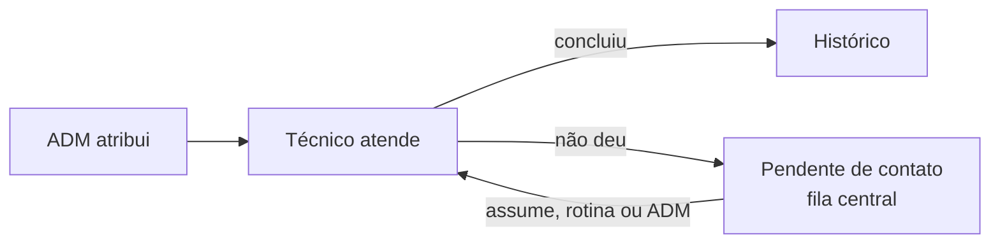

# Sistema de Verificação de Rotina

Sistema web para equipes de suporte organizarem **verificações rotineiras de clientes (PPPoE)**: o administrador atribui,
o técnico atende e registra, e o sistema acompanha prazo, produção e tempo, **sem deixar trabalho parado** (o que não é
concluído vai para uma fila compartilhada e pode ser redistribuído automaticamente, de forma justa).

Roda em qualquer servidor com **Apache ou Nginx + PHP 8 + MySQL/MariaDB**.

```
Navegador ──HTTP──▶ Apache/Nginx + PHP ──▶ MySQL/MariaDB
 (index.html)        (api.php)              (o banco que você já tem)
                          └─ rotinas automáticas: redistribuição, métricas, manutenção, backup
```

## Documentação

Comece pelo guia do seu papel. Cada documento é independente e aponta para o seguinte.

| # | Documento | Para quem | O que explica |
|---|---|---|---|
| 1 | [Visão geral](docs/01-visao-geral.md) | Todos | O que o sistema faz, perfis, **glossário**, mapa de telas e o caminho de uma verificação |
| 2 | [Guia do técnico](docs/02-guia-do-tecnico.md) | Técnicos | Atender, observações obrigatórias, deixar pendente, assumir e receber pendências |
| 3 | [Guia do administrador](docs/03-guia-do-administrador.md) | ADM | Cada tela do menu: gráficos, atribuições, procedimentos, pendências, redistribuição, usuários, sistema |
| 4 | [Regras e fluxos](docs/04-regras-e-fluxos.md) | ADM e equipe técnica | **As regras de negócio**: estados, permissões, pendência de ponta a ponta, redistribuição justa, limite de trocas, auditoria |
| 5 | [Arquitetura, banco e API](docs/05-arquitetura-e-api.md) | Desenvolvedores | Camadas, tabelas, migrations, rotas da API, rotinas, configuração e segurança |
| 6 | [Instalação, atualização e operação](docs/06-instalacao-e-operacao.md) | Quem mantém o servidor | Instalar, acessar por IP, migrar, atualizar com rollback, backup/restauração, cron, limitações |

Histórico de versões: [CHANGELOG.md](CHANGELOG.md).

## Em 5 minutos

1. **Requisitos:** PHP 8.0+ com `pdo_mysql`, MySQL 5.7+/MariaDB 10.3+ com um banco vazio e um usuário com todos os privilégios sobre ele.
2. **Instalar:** descompacte em `/var/www/rotina`, rode `sudo ./install.sh` e conclua pelo navegador (`http://IP-DO-SERVIDOR/install.php`) ou pelo terminal (`./rotina install`). Detalhes em [Instalação e operação](docs/06-instalacao-e-operacao.md).
3. **Entrar:** use o administrador criado na instalação. Os técnicos criam o cadastro na tela de login e **o administrador aprova**.
4. **Configurar o essencial** (cerca de 10 minutos): em **Procedimentos**, confira a lista; em **Redistribuição**, escolha os turnos e ligue a rotina (opcional); em **Atribuição por Planilha**, importe o primeiro conjunto.

## Como o trabalho flui (resumo)



- Cada verificação tem **dono, prazo e prioridade**; só pode haver **uma aberta por PPPoE**.
- As **Observações** são exclusivas do técnico e **obrigatórias** para concluir. O que é automático (origem, trocas, quem assumiu) fica na **auditoria**.
- Quem recebe uma pendência vê um **aviso** informando que ela estava pendente de contato, com a nota curta (até 200 caracteres) de quem deixou.
- A **Redistribuição** (desligada por padrão) entrega as pendências de forma **justa entre os turnos**, com limite de trocas por verificação; o ADM pode **designar** manualmente a qualquer momento.

Todas as regras, com exemplos, estão em [Regras e fluxos](docs/04-regras-e-fluxos.md).

## Estrutura do projeto

```
public/        ÚNICA pasta exposta na web: index.html, api-adapter.js, api.php, install.php (some após instalar)
app/           código PHP (Api, Sync, Auth, Redistribution, Backup, Updater, Installer, Migrator, Jobs...)
bin/rotina.php ferramenta de terminal   ·   ./rotina  atalho que roda como o dono dos arquivos
migrations/    001 a 015 (alterações do banco, sempre aditivas)
config/        config.php (gerado pelo instalador, privado) · config.sample.php (todas as opções)
storage/       backups, logs, releases (cópias para rollback), privado
deploy/        modelos de Apache (IP e subpasta) e Nginx
tests/         testes das regras da redistribuição (PHP, sem banco) e da API (Node)
docs/          esta documentação
install.sh     preparação + instalação guiada
```

## Comandos do dia a dia

```bash
./rotina status        # versão, banco, migrations, último backup
./rotina backup        # backup agora
./rotina update pacote.zip
./rotina rollback      # volta o código da versão anterior
./rotina cron          # rotinas agendadas (use a cada minuto se o cron substituir o automático)
curl -s http://IP/api.php?r=healthz     # monitoramento
```

## Segurança em poucas linhas

Senhas com bcrypt; permissões conferidas **no servidor**; sessão em cookie assinado e relida do banco a cada requisição;
proteção contra CSRF; limite de tentativas por IP; auditoria de quem fez o quê; pastas internas fora da web.
Lista completa em [Arquitetura](docs/05-arquitetura-e-api.md#8-segurança-resumo-técnico) e [Instalação e operação](docs/06-instalacao-e-operacao.md#9-segurança).
