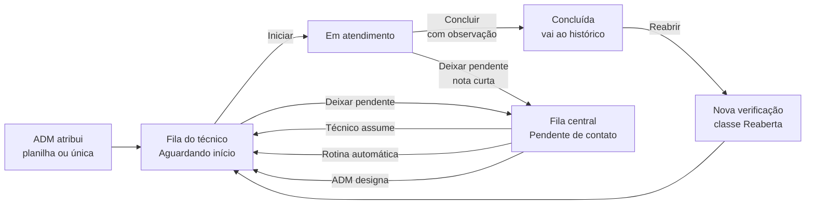

# 1. Visão geral: o que o sistema faz

[← Índice](../README.md#documentação) · Próximo: [Guia do técnico →](02-guia-do-tecnico.md)

## Para que serve

O **Sistema de Verificação de Rotina** organiza o trabalho de uma equipe de suporte que precisa **verificar clientes
(logins PPPoE) de forma rotineira**. Em vez de planilhas e mensagens soltas:

- o **administrador (ADM)** cadastra quais clientes devem ser verificados, para qual técnico, até quando, e acompanha tudo;
- o **técnico (TEC)** vê a sua fila, atende cada cliente, registra o que fez e conclui;
- o **sistema** guarda o histórico de cada verificação, mede produção, prazo e tempo de atendimento, e cuida de
  **não deixar trabalho parado**: o que um técnico não consegue concluir vai para uma fila compartilhada e pode ser
  redistribuído automaticamente, de forma justa.

Tudo roda no navegador, sem instalar nada nos computadores da equipe. O servidor é um Apache/Nginx com PHP e MySQL/MariaDB.

## Quem usa

| Perfil | O que faz | Como entra |
|---|---|---|
| **ADM** (administrador) | Atribui verificações, define procedimentos e regras, aprova cadastros, acompanha gráficos, resolve pendências, faz backup e atualização | Criado na instalação (ou por `./rotina create-admin`, ou por outro ADM em *Gerenciar usuários*) |
| **TEC** (técnico) | Atende as verificações da sua fila, deixa pendente o que não conseguiu concluir, assume pendências e verificações de colegas | Cria o cadastro na tela de login e **aguarda o ADM aprovar** |

Situação de uma conta: **Pendente** (aguardando aprovação, ainda não entra), **Aprovado** (entra) ou **Bloqueado** (não entra).
O turno da pessoa é **Manhã, Tarde, Noite ou Madrugada** (escolhido no cadastro) ou **Geral**, que só o administrador define (é um curinga: a Redistribuição o considera em qualquer turno marcado).

## Glossário

| Termo | Significado |
|---|---|
| **Verificação** | Uma tarefa: verificar um cliente (PPPoE) até um prazo. É a unidade de trabalho do sistema. |
| **PPPoE / login** | O identificador do cliente. Só pode existir **uma verificação aberta por PPPoE** ao mesmo tempo. |
| **Conjunto (lote)** | Grupo de verificações criado de uma vez por **Atribuição por Planilha**. Tem um nome. |
| **Atribuição única** | Verificação criada uma a uma, pela tela *Atribuição Única*. |
| **Prazo** | Data limite da verificação. Aberta e com prazo anterior a hoje = **atrasada**. |
| **Prioridade** | Normal, Alta ou Urgente. Influencia a ordem de distribuição das pendências (urgente primeiro). |
| **Turno** | Período de trabalho do técnico (e da verificação). |
| **Classe** | **Normal**, **Adicional** (o PPPoE já teve verificação concluída antes) ou **Reaberta** (nova verificação gerada ao reabrir uma concluída). |
| **Procedimento** | O que foi feito no atendimento (ex.: "Troca de equipamento"). A lista é definida pelo ADM. |
| **Checklist** | Quatro marcações do atendimento: *Ligou*, *Não atende*, *Resolvido*, *O.S. aberta*. |
| **Observações** | Texto livre **escrito pelo técnico** sobre o que ele fez. Só o técnico escreve ali. |
| **Em aberto** | Qualquer verificação **ainda não concluída** (aguardando início, em atendimento ou pendente de contato). É o termo dos filtros e dos números do menu. |
| **Pendente de contato** | Um caso específico de "em aberto": a verificação que o técnico **não conseguiu concluir** e deixou numa área compartilhada. Não é sinônimo de "em aberto". |
| **Fila central** | O conjunto de todas as pendências de contato, ainda sem técnico responsável efetivo. |
| **Passagem de bastão** | Quando outro técnico recebe a pendência, a nota de quem deixou chega junto, como aviso. |
| **Redistribuição** | Rotina automática que passa as pendências da fila central a técnicos, de forma justa. |
| **Trocas** | Quantas vezes o **sistema** já mudou aquela verificação de técnico (há um limite). |
| **Auditoria / linha do tempo** | Registro de tudo o que aconteceu com uma verificação (criada, iniciada, pendente, concluída…). |

## O caminho de uma verificação

Em uma frase: **o ADM atribui → o técnico atende e conclui → se não conseguir, deixa pendente → a fila central devolve a
verificação a alguém (o próprio técnico, a rotina ou o ADM) → até concluir.** Detalhes de cada etapa em
[Regras e fluxos](04-regras-e-fluxos.md).

## Mapa de telas

**Administrador** (menu lateral):

| Item | O que é |
|---|---|
| Analytics & Tendências | Indicadores e 7 gráficos de produção, prazo, tempo e equipe |
| Verificação → Conjuntos / Atribuições únicas | Listas do que foi atribuído e seu andamento |
| Banco de Verificações | Todas as verificações, com busca, filtros, reatribuição e exclusão |
| Equipe & Aprovações → Equipe / Aprovações / Gerenciar usuários | Presença da equipe, aprovar cadastros, editar usuários |
| Sistema | Saúde, backup/restauração, atualização, marca |
| Procedimentos | Lista de procedimentos que o técnico escolhe |
| Redistribuição | Liga e configura a rotina automática |
| Pendências | Fila central: ver, designar, distribuir, ranking |
| Atribuição Única | Cria uma verificação para um PPPoE |
| Atribuição por Planilha | Cria várias verificações de uma planilha ou lista |

**Técnico**:

| Item | O que é |
|---|---|
| Minha Verificação | Sua fila ativa; é daqui que você atende |
| Pendentes de contato | Pendências da fila central que você pode assumir |
| Verificações dos outros técnicos | Assumir verificações abertas de colegas |
| Histórico Concluído | Suas verificações concluídas (e reabrir) |
| Equipe | Quem está online e perfis dos colegas |
| Meu Dashboard | Seus indicadores pessoais |

## Regras que valem em todo o sistema

- **Só o técnico escreve nas Observações.** Origem da atribuição, reatribuições, quem assumiu, histórico anterior: tudo isso fica na **auditoria**, nunca no campo de observações.
- **Nada se perde.** Concluir, reabrir, redistribuir ou designar nunca apaga o histórico; apenas acrescenta eventos.
- **Segurança no servidor.** O que cada perfil pode fazer é conferido no servidor; a tela só esconde os botões.
- **Mais de uma pessoa mexendo ao mesmo tempo é seguro.** Se alguém alterou a verificação antes de você, o sistema avisa e recarrega, sem sobrescrever o trabalho do outro.
- **Atualização automática.** A tela confere mudanças a cada poucos segundos; não é preciso recarregar a página.
