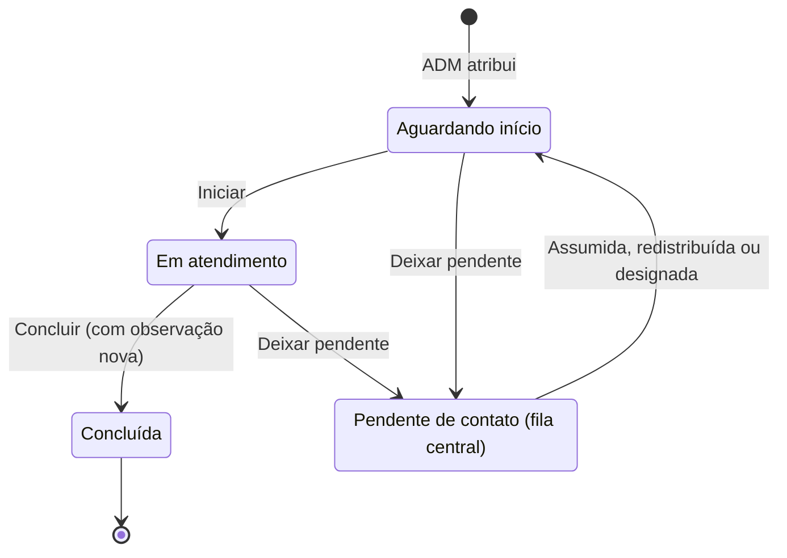
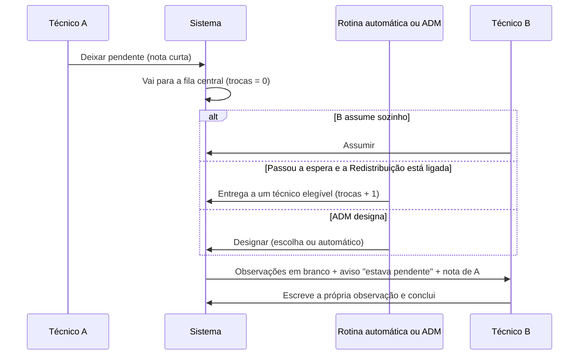

# 4. Regras e fluxos

[← Guia do administrador](03-guia-do-administrador.md) · Próximo: [Arquitetura e API →](05-arquitetura-e-api.md)

Este documento é a **fonte de verdade das regras de negócio**: o que o sistema permite, proíbe e faz sozinho.

## 1. Estados de uma verificação

| Estado | Como se reconhece | Onde aparece |
|---|---|---|
| **Aguardando início** | Aberta, com técnico, ainda não iniciada | *Minha Verificação* do técnico |
| **Em atendimento** | O técnico clicou em *Iniciar* | *Minha Verificação* |
| **Pendente de contato** | O técnico deixou na fila central | *Pendentes de contato* (técnicos) e *Pendências* (ADM) |
| **Concluída** | O técnico concluiu | *Histórico Concluído* e *Banco de Verificações* |
| **Atrasada** | Aberta e com prazo **anterior a hoje** | Selo no cartão e filtros "Atrasadas" |

**"Em aberto" não é o mesmo que "pendente de contato".** *Em aberto* é tudo o que ainda não foi concluído (aguardando início, em atendimento ou pendente de contato); *pendente de contato* é só o caso em que o técnico deixou a verificação na fila central. Nos filtros e nos números do menu o sistema usa "em aberto" para o primeiro e "pendente de contato" para o segundo.

"Atrasada" não é um estado separado: é uma marcação que vale para qualquer verificação **não concluída** cujo prazo já passou.

**O que acontece em cada passagem:**

- **Iniciar:** grava o horário de início (só na primeira vez).
- **Concluir:** grava o horário de conclusão e leva ao histórico. O tempo de atendimento é *início → conclusão*.
- **Deixar pendente:** sai da fila do técnico, guarda a nota e o momento (`pendente desde`), e encerra o "em atendimento".
- **Assumir / receber pendência:** o novo técnico passa a ser o dono; a pendência sai da fila central; **o relógio de atendimento recomeça**
  (o tempo parado na fila nunca conta como atendimento).
- **Reabrir:** não "desfaz" a conclusão. Cria uma **nova** verificação (veja a seção 3).

## 2. Quem pode fazer o quê

O servidor confere tudo isso; a tela apenas esconde o que a pessoa não pode usar.

| Ação | ADM | TEC |
|---|---|---|
| Criar verificações (planilha ou única) | Sim | Não (só **reabrir** as suas) |
| Alterar prazo, prioridade, turno e conjunto; reatribuir; excluir | Sim | Não |
| Preencher o atendimento (checklist, procedimento, observações), iniciar, concluir, deixar pendente | Sim | **Só o dono** da verificação |
| Assumir uma pendência da fila central | Sim (designando) | Sim, para si mesmo |
| Assumir uma verificação aberta de outro técnico | Sim (reatribuindo) | Sim, **para si mesmo** |
| Designar pendência a alguém; ligar e configurar a Redistribuição | Sim | Não |
| Gerenciar procedimentos, usuários, backup, atualização, marca | Sim | Não |
| Ver o banco global, o ranking e os gráficos de toda a equipe | Sim | Não (vê o próprio dashboard) |

## 3. Classes e duplicidade

- **Só pode existir uma verificação aberta por PPPoE.** Isso é garantido pelo banco de dados, não só pela tela.
  Ao atribuir um PPPoE que já tem verificação aberta, o sistema **reatribui** a existente (planilha: ou **mantém**, se você marcar
  *Não mexer nas que ainda estão em aberto*).
- **Normal:** primeira verificação do PPPoE.
- **Adicional:** o PPPoE **já teve** verificação concluída. A classe vem do **histórico real** (quantas verificações anteriores existem), não só do que estava gravado.
- **Reaberta:** nasce ao reabrir uma concluída. É uma verificação **nova**, ligada à anterior; a anterior permanece intacta, com o resultado que teve.
- **Cada verificação é independente**: o contador de trocas (seção 6) **recomeça em 0** na reaberta ou na adicional. O contador da anterior fica guardado nela.

## 4. Observações: a regra de ouro

**O campo de observações é exclusivo do técnico.** O sistema não escreve nada automático nele.

| Informação | Onde fica |
|---|---|
| O que o técnico fez | **Observações** (só ele escreve) |
| Nota de pendência ("o que tentei / o que falta", 3 a 200 caracteres) | No aviso de **passagem de bastão**, para quem receber |
| Observações que existiam quando a pendência foi recebida | **Auditoria** (evento da troca, bloco "Observações anteriores", até 2000 caracteres) |
| Origem da atribuição (planilha, cotas, única) | **Auditoria** (evento *Verificação criada*) |
| Nota do ADM ao reatribuir | **Auditoria** (evento *Reatribuída*) |
| Quem assumiu, retomou, designou ou redistribuiu | **Linha do tempo** da verificação |

Exceção intencional: o campo **"Problema detectado / observações iniciais"** da *Atribuição Única* é texto escrito pelo ADM e vai para as observações.

**Para concluir**, o técnico precisa escrever algo **novo** (mínimo de 5 caracteres). Texto que já existia quando ele abriu a verificação não vale.
Quem recebe uma pendência já começa com o campo vazio, então essa regra vale para ele também.

## 5. Pendência de ponta a ponta

**Quatro caminhos para sair da fila central:**

1. **Um técnico assume** (aba *Pendentes de contato*). Não conta como "troca".
2. **A rotina automática** entrega (se estiver ligada e já passou o tempo de espera). Conta +1 troca.
3. **O ADM designa um técnico** (*Pendências → Designar*). Zera as trocas.
4. **O ADM usa o automático** para uma só pendência (*Designar → Redistribuição automática*) ou para todas (*Distribuir todas pelo automático*). Conta +1 troca. *Distribuir todas* respeita o limite de trocas; *Designar → automático* não (veja a seção 6).

**Passagem de bastão:** quem recebe vê um aviso informativo, "Esta verificação estava pendente de contato", com
quem deixou, há quanto tempo e a nota. O cartão ganha o selo **RECEBIDA**. O aviso some quando a verificação é concluída.
Se a mesma pessoa retoma a **própria** pendência, nada é limpo e não aparece "recebida".

## 6. Redistribuição automática

A rotina entrega as pendências da fila central a técnicos, **de forma justa**, sem ninguém precisar clicar. Vem **desligada**.

### Quando roda

- No máximo **uma vez por minuto**, enquanto alguém estiver com o sistema aberto (cada navegador consulta o servidor a cada 5 s e isso dispara a rotina).
- Também pelo agendador do servidor: `./rotina cron` (útil para rodar mesmo sem ninguém conectado; agende a cada minuto).
- Só age se estiver **ligada**. Um **bloqueio** no banco impede duas execuções ao mesmo tempo.

### O que entra na distribuição

Pendências que estão na fila central, **não concluídas**, ainda **abaixo do limite de trocas** e, na rotina automática, que
**esperam há pelo menos o tempo configurado** (padrão 30 min). *Distribuir agora, sem esperar* ignora só essa espera.
Ordem: **Urgente → Alta → Normal** e, dentro de cada uma, a que espera há mais tempo. Até 200 por execução.

### Quem pode receber

Técnico **aprovado**, **não bloqueado**, de um **turno marcado** (ou "Geral") e com a fila **abaixo do limite por técnico**
(padrão 15). A "carga" de uma pessoa é o número de verificações abertas dela que não estão pendentes.
**Presença online não conta**: o que decide é turno, limite e carga.

### Como escolhe (a regra justa)

Modo **Quem tem menos trabalho** (padrão), nesta ordem:

1. o **turno** com menor carga média por técnico (equilibra os turnos);
2. dentro dele, o técnico com **menos verificações**;
3. em empate, quem **recebeu menos hoje**;
4. persistindo o empate, **passa a vez**: vai para o próximo na ordem fixa, depois de quem recebeu por último. Assim o mesmo nome nunca fica sempre na frente.

Modo **Rodízio**: ordem fixa de técnicos, cada um na sua vez, continuando de onde parou, sem olhar a carga.

Em ambos: **não devolve** a pendência a quem acabou de deixá-la, a menos que seja o único elegível.
Se ninguém puder receber (todos no limite ou nenhum turno com técnico), a pendência **continua na fila central**; nada se perde.

### O limite de trocas

Cada vez que o **sistema** passa a verificação a outro técnico, o contador **Trocas** soma 1. A rotina só pega pendências com
`trocas < limite` (padrão 3), então ela pode ser entregue **3 vezes** pelo sistema (e passar por até 4 técnicos contando o original).
Depois disso, o sistema **para** e ela fica na fila central, no cartão **Precisam de você**.

- **Não soma:** o técnico deixar pendente; um técnico assumir sozinho; reatribuição comum do ADM.
- **Zera:** o ADM **designar** a um técnico escolhido.
- **Soma 1 e ignora o limite de trocas:** *Designar → Redistribuição automática* numa pendência só (decisão explícita do ADM). Ele continua respeitando os turnos marcados e o limite de verificações por técnico.
- Mudar o limite na tela vale na hora para todas (subir "libera" as paradas; descer trava mais).
- O contador pertence à **verificação**; uma reaberta nasce com 0.

Note que o limite impede o **sistema** de mexer, mas **qualquer técnico ainda pode assumir** uma pendência parada pela aba *Pendentes de contato*.

### Como a troca é feita (segurança)

- É **a mesma verificação** que muda de dono: nada é copiado, o histórico, o prazo e a classe permanecem.
- É um `UPDATE` **condicional** (ainda pendente, não concluída, mesma versão). Se um técnico assumir no mesmo instante, quem chegou primeiro vence e a outra tentativa é ignorada, sem duplicar nada.
- Quem recebe: observações em branco, nota como aviso, relógio de atendimento zerado.
- Fica registrado o evento **Redistribuída automaticamente** (sem autor: é o sistema) e, na auditoria do ADM, de quem para quem. O texto que a equipe vê é neutro e só diz o destino.
- A troca **não** conta como "retomou" no ranking.

## 7. Auditoria e retenção

- **Linha do tempo da verificação** (`verification_events`): criada, atendimento iniciado, checklist, procedimento, observação, ajustes, deixada pendente, retomada, designada, redistribuída, reatribuída, assumida, concluída, reaberta. Fica **enquanto a verificação existir**.
- **Auditoria geral** (`audit_log`): ações do sistema e dos usuários (login, criação, alterações, backups, configuração). Mantida por **365 dias** (configurável).
- Excluir uma verificação remove também a linha do tempo dela.

## 8. Edição simultânea

Cada verificação tem um número de **versão**. Se duas pessoas alteram a mesma verificação ao mesmo tempo, a segunda recebe o aviso
*"Esta verificação foi alterada por outra pessoa. Os dados foram recarregados — refaça a ação."*; nada é sobrescrito. Se a conexão
cair, o navegador guarda as alterações e **reenvia sozinho** ao voltar.

## 9. Indicadores (como são calculados)

| Indicador | Cálculo |
|---|---|
| **Concluídas** | Verificações com data de conclusão no período |
| **Resolvido direto** | Concluídas marcadas como *Resolvido* (sem O.S.) |
| **O.S.** | Concluídas com *O.S. aberta* |
| **Cumprimento do prazo** | Concluídas em que a **data da conclusão ≤ data do prazo** |
| **Tempo médio de atendimento** | Média de *início → conclusão*, ignorando atendimentos acima de 8 h |
| **Atrasadas** | Abertas com prazo anterior a hoje |
| **Em aberto por atraso** | Abertas em faixas: a vencer, vence hoje, atrasada hoje, 1 dia, 2–3, 4–7 e mais de 7 dias de atraso |
| **Pendências "Acima de 24h"** | Pendentes há 24 h ou mais |
| **Quem deixa / retoma** | Eventos *Deixada pendente* e *Pendência retomada* por técnico no período |
