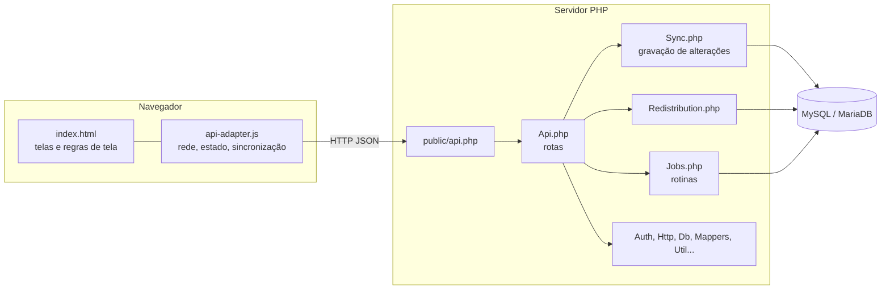

# 5. Arquitetura, banco de dados e API

[← Regras e fluxos](04-regras-e-fluxos.md) · Próximo: [Instalação e operação →](06-instalacao-e-operacao.md)

Para quem mantém o código. Em uma frase: **uma página única no navegador conversa com um PHP simples (sem framework) que grava em MySQL/MariaDB.**

## 1. Visão em camadas

## 2. Front-end

- **`public/index.html`** contém todas as telas, estilos e a lógica de interface (uma única página, sem build).
  Usa Tailwind, Chart.js e FontAwesome por CDN (e leitura de planilhas no navegador); o navegador precisa de internet para elas.
- **`public/api-adapter.js`** é a camada de rede. Mantém o **estado em memória** (`state`) e fala com o servidor.
  O parâmetro `?v=` no `<script>` força o navegador a baixar a versão nova a cada release.
- **Como a tela fica atualizada:**
  1. A cada **5 s** o navegador pergunta `stamp` (consulta minúscula). Só se o carimbo mudou ele baixa os dados (`bootstrap`).
  2. Quando o usuário altera algo, o adaptador envia **só o que mudou** (`sync`); se a rede cair, tenta de novo sozinho.
  3. A cada **15 s** um batimento atualiza a presença na equipe (o servidor limita a gravação a 1 vez por 20 s).
- A tela esconde o que o perfil não pode usar, mas **quem decide é o servidor**.

## 3. Back-end (`app/`)

| Arquivo | Responsabilidade |
|---|---|
| `Api.php` | Roteamento (`api.php?r=...`) e os endpoints de leitura/escrita |
| `Sync.php` | **Grava** alterações de verificações, usuários e procedimentos: valida, aplica permissões, controla versão e gera os eventos de auditoria, tudo em transação |
| `Redistribution.php` | Regra e execução da redistribuição automática e da designação de pendências |
| `Auth.php` | Sessão por cookie assinado (HMAC-SHA256), relida do banco a cada requisição |
| `Http.php` | Entrada/saída JSON, limite de tentativas por IP, erros (`HttpError`) |
| `Db.php` | Conexão PDO, transações, travas (`GET_LOCK`), fuso horário |
| `Mappers.php` | Converte linhas do banco em objetos para a tela (inclui a classe real da verificação) |
| `Jobs.php` | Rotinas agendadas "de carona" (métricas, manutenção, backup, redistribuição) |
| `Backup.php`, `Updater.php`, `Installer.php`, `Migrator.php`, `SqlSplitter.php`, `System.php` | Backup/restauração, atualização com rollback, instalação, migrations, tela Sistema |
| `Branding.php` | Plano de fundo da tela de login |
| `Config.php`, `Util.php` | Configuração, utilidades (IDs, auditoria, texto) |

Princípios: **sem framework**, `declare(strict_types=1)`, SQL com parâmetros, todo erro "esperado" vira `HttpError` com mensagem em português.

## 4. Banco de dados

### Tabelas

| Tabela | Conteúdo |
|---|---|
| `users` | Contas. `role` (ADM/TEC), `shift` (Manhã, Tarde, Noite, Madrugada, Geral), `status` (Pendente/Aprovado/Bloqueado), senha (bcrypt), presença (`last_seen_at`), `token_version` (invalida sessões ao trocar a senha) |
| `verifications` | **A verificação** (veja abaixo) |
| `verification_events` | Linha do tempo de cada verificação (um registro por evento, com `details` em JSON) |
| `batches` | Conjuntos criados por planilha (e agrupamentos nomeados) |
| `actions` | Procedimentos (com exclusão lógica em `deleted_at`) |
| `audit_log` | Auditoria geral (quem fez o quê, com IP); retenção configurável |
| `daily_metrics` | Totais diários por técnico (alimenta os gráficos) |
| `rate_limits` | Contadores de tentativas por IP |
| `app_state` | Pares chave/valor do sistema: configuração da Redistribuição (`redist`), ponteiro do rodízio (`redist_rr`), última conferência (`redist_ts`), última execução (`redist_last`, marcadores das rotinas) |
| `schema_migrations` | Quais migrations foram aplicadas (com checksum) |

### A tabela `verifications` (grupos de colunas)

| Grupo | Colunas |
|---|---|
| Identidade | `id`, `pppoe`, `batch_id`, `created_by`, `created_at`, `updated_at` |
| Atribuição | `tech_id`, `shift`, `due_date`, `priority`, `is_single` |
| Classe e histórico | `kind` (Normal/Adicional/Reaberta), `prev_count` (quantas verificações anteriores do PPPoE), `repeat_of` (a anterior) |
| Atendimento | `ligou`, `nao_atende`, `resolvido`, `os_criada`, `action_id`, `obs`, `em_execucao`, `started_at`, `finished_at`, `finalizado`, `handle_time_min` |
| Pendência | `pending_contact`, `pending_since`, `pending_note` |
| Passagem de bastão | `handoff_note`, `handoff_from`, `handoff_at` |
| Redistribuição | `redist_count` (trocas feitas pelo sistema), `redist_at` (última troca) |
| Controle | `version` (concorrência otimista), `active_pppoe` (coluna que garante **uma verificação aberta por PPPoE**) |

`active_pppoe` tem índice **único**: o banco impede duas verificações abertas do mesmo PPPoE, independentemente da tela.

### Migrations (`migrations/`)

São **sempre aditivas** e aplicadas em ordem; o checksum impede alterar uma já aplicada.

| # | Para que serve |
|---|---|
| 001 | Esquema inicial |
| 002 | Procedimentos padrão (versão original) |
| 003 | Tabelas de apoio da versão PHP (limite de tentativas, estado do sistema) |
| 004 | Linha do tempo (histórico) de cada verificação |
| 005 | Perfil do técnico (bio) e presença online |
| 006 | Turno "Madrugada" e foto de perfil |
| 007 | Corrige classe e contagem de anteriores de PPPoE antigos |
| 008 | Classe "Reaberta" (reabrir cria uma verificação nova) |
| 009 | Remove histórico "órfão" de verificações já excluídas |
| 010 | Lista atual de procedimentos padrão |
| 011 | Marca as verificações de "Atribuição Única" |
| 012 | "Pendente de contato" (fila compartilhada) |
| 013 | Redistribuição: `redist_count`, `redist_at` |
| 014 | Índices para grande volume (gráficos, sincronização, redistribuição) |
| 015 | Passagem de bastão (`handoff_*`) |

## 5. API

Tudo passa por `public/api.php?r=<rota>`. Respostas em JSON; erros trazem `{"error": "mensagem em português"}`.
Métodos que alteram dados exigem **POST** e o cabeçalho anti-CSRF; a sessão vai em cookie `httpOnly`.

| Rota | Método | Quem | Para que serve |
|---|---|---|---|
| `healthz` | GET | público | Monitoramento (`{"status":"ok"}`) |
| `auth/login` · `auth/register` · `auth/logout` · `auth/me` | POST/POST/POST/GET | público/logado | Entrar, pedir cadastro, sair, ver a própria sessão |
| `bootstrap` | GET | logado | Carga inicial da tela (usuários, verificações, procedimentos); dispara as rotinas depois de responder |
| `stamp` | GET | logado | Carimbo de mudança (polling leve); também aciona a redistribuição, depois de responder |
| `sync` | POST | logado | Grava alterações (criar, editar, excluir) com validação, permissões e versão |
| `analytics` | GET | logado | Séries dos gráficos por período (semana/mês/ano) |
| `team` | GET | logado | Presença e situação da equipe (também registra o batimento) |
| `profile`, `profile/verifications` | GET | logado | Perfil de um técnico e suas verificações |
| `profile/bio` · `profile/avatar` | POST | logado | Editar o próprio perfil |
| `avatar` | GET | logado | Foto de perfil |
| `verification/audit` | GET | logado | Linha do tempo de uma verificação |
| `verification/search` | GET | logado | Busca de verificações concluídas (*Soluções da equipe*) |
| `pppoe/check` | POST | ADM | Histórico de uma lista de PPPoE antes de atribuir |
| `pending/stats` | GET | ADM | Ranking *quem deixa / quem retoma* (`days`) |
| `audit` | GET | ADM | Auditoria geral |
| `export/verifications.csv` | GET | ADM | Exporta verificações (`from`, `to`; padrão últimos 30 dias). CSV com `;` e BOM para abrir no Excel; protegido contra injeção de fórmula. *Não há botão na tela: acesse pela URL* |
| `branding/login` · `branding/login-file` | GET | público | Plano de fundo da tela de login |
| `admin/system` | GET | ADM | Estado do sistema (versão, banco, backups, manutenção) |
| `admin/redistribution` | GET/POST | ADM | Lê / salva a configuração (e o estado) da Redistribuição |
| `admin/redistribution/run` | POST | ADM | Simular (`dry`) ou executar agora |
| `admin/pending/assign` | POST | ADM | Designar uma pendência (`id`, `techId` opcional; sem `techId` usa o automático) |
| `admin/redistribution/suggest` | POST | ADM | Sugere técnicos para N novas demandas pela mesma regra. **Sem uso na interface atual** (reservada) |
| `admin/db-test` | POST | ADM | Testa a conexão com o banco |
| `admin/backup`, `.../download`, `.../delete`, `.../prune`, `.../restore` | POST/GET | ADM | Backup e restauração |
| `admin/update` · `admin/rollback` | POST | ADM | Atualizar por `.zip` / voltar a versão anterior |
| `admin/branding`, `.../chunk`, `.../finish`, `.../remove` | GET/POST | ADM | Enviar e remover o plano de fundo (envio em partes) |

### Como o `sync` protege os dados

1. Roda **numa transação** e só aceita campos conhecidos, com tamanhos e formatos validados.
2. **Permissões por perfil** (ADM altera tudo; técnico só os campos do atendimento, e só o dono).
3. **Versão otimista:** cada verificação tem `version`. Se a versão enviada não é a do banco, a gravação é recusada com o aviso de que outra pessoa alterou.
4. Passagens especiais (assumir pendência, reabrir) têm regras próprias, descritas em [Regras e fluxos](04-regras-e-fluxos.md).
5. Gera os **eventos de auditoria** na mesma transação (se algo falha, nada é gravado pela metade).

## 6. Rotinas agendadas

Rodam **depois de responder ao usuário**, protegidas por trava no banco (nunca duplicam).

| Rotina | Quando | O que faz |
|---|---|---|
| Redistribuição | A cada ~1 min (se ligada) | Distribui a fila central (veja [Regras e fluxos](04-regras-e-fluxos.md#6-redistribuição-automática)) |
| Métricas do dia | A cada 30 min | Atualiza `daily_metrics` |
| Fechamento e manutenção | Depois das 00:10 | Fecha o dia anterior; aplica a retenção da auditoria; limpa tentativas antigas |
| Backup | Diário, depois das 02:30 | Backup automático com rotação |

Disparam por `bootstrap`, por `stamp` (redistribuição) ou por `./rotina cron`. Se `auto_jobs` estiver `false`, só o `cron` as dispara.

## 7. Configuração (`config/config.php`)

O instalador gera o essencial (`db`, `secret`, `tz`). As demais chaves usam o padrão; todas estão comentadas em `config/config.sample.php`.

| Chave | Padrão | Efeito |
|---|---|---|
| `session_hours` | 12 | Duração da sessão |
| `cookie_secure` | `auto` | `Secure` só em HTTPS (`auto`), ou forçar `true`/`false` |
| `trust_proxy` | `false` | `true` só atrás de proxy reverso confiável |
| `bcrypt_cost` | 12 | Custo das senhas |
| `bootstrap_days` | 120 | Dias de histórico concluído que a tela carrega |
| `audit_retention_days` | 365 | Retenção da auditoria geral |
| `auto_jobs` | `true` | Rotinas "de carona"; com cron, use `false` |
| `backup` | `auto`, `02:30`, 14 diários, 6 mensais, 10 rotulados | Backup automático e rotação |

**Configuração da Redistribuição** (guardada no banco, em `app_state`, chave `redist`; editada pela tela):

| Campo | Significado | Padrão |
|---|---|---|
| `on` | Liga a rotina | 0 |
| `how` | `L` menos trabalho, `R` rodízio | `L` |
| `wait` | Espera mínima antes de distribuir (min) | 30 |
| `cap` | Máximo de verificações por técnico | 15 |
| `max` | Máximo de trocas por verificação | 3 |
| `en` | Turnos que recebem | todos |
| `when`, `win`, `sh` | Restos de uma versão anterior (abertura de turno). **Sem efeito**: a rotina não usa mais janela de horário | — |

## 8. Segurança (resumo técnico)

- Senhas com **bcrypt**; mínimo de 4 caracteres (sistema interno). Tempo de resposta igual para e-mail inexistente.
- **Não há bloqueio de conta por tentativas erradas**: errar a senha nunca trava o usuário. Há **limite por IP** (30 tentativas de login por 15 min; 10 pedidos de cadastro por hora), gravado no banco.
- Sessão em cookie `httpOnly` + `SameSite=Strict`, assinada; **relida do banco a cada requisição** (bloquear, rebaixar ou trocar senha vale na hora).
- Permissões **no servidor**; cabeçalho anti-CSRF; campos de texto curtos filtrados contra XSS; CSV protegido contra injeção de fórmula.
- Auditoria de login, criação, alteração, backup e configuração, com IP.
- `app/`, `config/`, `storage/`, `bin/`, `migrations/` fora da web; erros PHP nunca aparecem para o visitante.

## 9. Testes

| Arquivo | O que cobre | Como rodar |
|---|---|---|
| `tests/redistribution.test.php` | Regras puras da redistribuição: escolha justa, rodízio, limite, validação da configuração | `php tests/redistribution.test.php` (não precisa de banco) |
| `tests/api.test.js` | Integração da API contra um servidor de teste (Node; só para desenvolvedores) | Veja o cabeçalho do arquivo |

## 10. Pontos de atenção conhecidos

- Há código **sem uso** da fase em que a Atribuição por Planilha/Única tinha um modo "Automático" (rota `admin/redistribution/suggest`, ramos `AUTO` no front, e `redist.when/win/sh`). É inofensivo e está listado aqui para não confundir; pode ser removido numa limpeza futura.
- `users.failed_logins` e `users.locked_until` existem no banco, mas o login **não bloqueia** mais contas; `locked_until` ainda é lido pela Redistribuição (quem estiver com bloqueio vigente não recebe).
